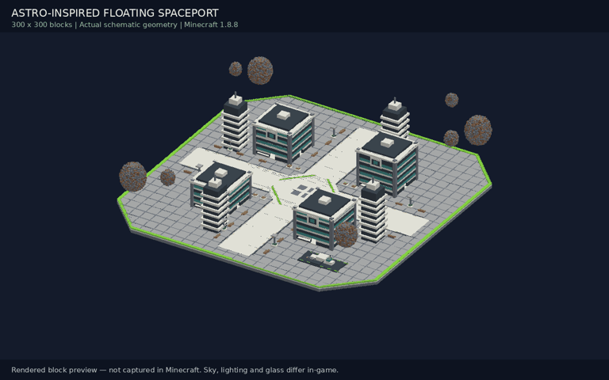
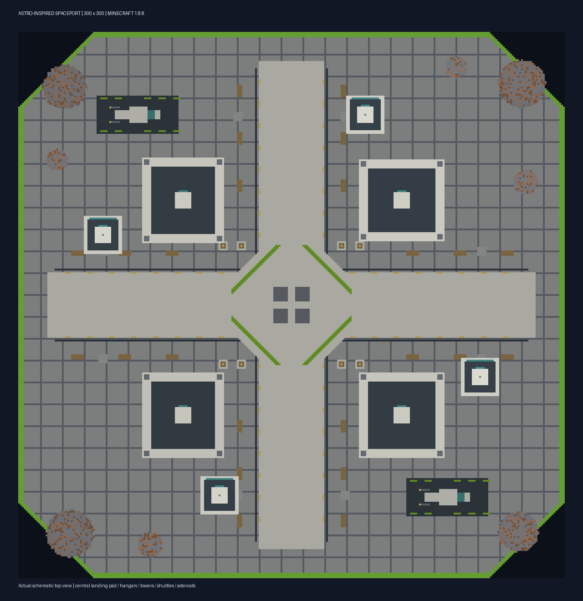

# Astro-inspired floating spaceport

Original 300 × 300 Minecraft Java 1.8.8 build inspired by a supplied Astro spawn screenshot. This is a WorldEdit schematic, not a standalone world save or an exact replica.

## Downloads

- [Download map package](https://github.com/ronylevixx123god-create/maps/raw/refs/heads/main/Astro-Inspired-Spaceport-300.zip)
- [Download overview video](https://github.com/ronylevixx123god-create/maps/raw/refs/heads/main/Astro-Spaceport-Overview.mp4)
- [Download video + still preview ZIP](https://github.com/ronylevixx123god-create/maps/raw/refs/heads/main/Astro-Spawn-Video.zip)
- [Schematic](spaceport-300/Astro-Inspired-Spaceport-300.schematic)
- [Installation instructions](spaceport-300/README.txt)

On a file page, use **Download raw file** to download rather than preview it.

## Rotating block-rendered overview



This is rendered from the actual schematic blocks, not recorded in Minecraft. Glass, lighting, textures and sky differ in-game.

## Layout



Flat floating octagonal deck within a 300 × 300 footprint, with four sci-fi buildings, observation towers, green accents, central plaza, decorative spacecraft and floating asteroids. Includes no functional NPCs, crates, region protection, terrain or warzone. Galaxy sky requires a separate resource pack.

## Import

Back up your world and test first. Copy the schematic into `plugins/WorldEdit/schematics/`. With WorldEdit 6 on Minecraft 1.8.8, fly to a clear location at Y=100, at the desired center, then run:

```text
//schematic load mcedit Astro-Inspired-Spaceport-300
//paste -a
```

The deck is one block below your paste position. Allow roughly 150 blocks of clearance in each horizontal direction and 85 blocks above. This paste contains approximately 550,000 blocks and may briefly stall the server. Use a void world for a floating-in-air result. See the full instructions before public use.

## Validation

Schematic gzip/NBT, dimensions, block arrays, Java 1.8.8-era block IDs and central spawn clearance were checked. ZIP integrity was verified. MP4 contains 96 frames at 1280 × 800 over 12 seconds. **Not yet imported or tested in Minecraft/WorldEdit.**

Editable Python generator and preview renderer are included under `spaceport-300/` (Python, NumPy and Pillow required; renderer also needs FFmpeg).
